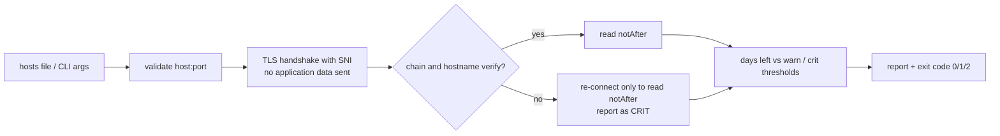

# cert-expiry-checker

[](https://github.com/AJJudkins/cert-expiry-checker/actions/workflows/ci.yml)

Expired TLS certificates cause outages that are entirely avoidable. This small Python tool checks the certificate expiry date of a list of hostnames, warns by days remaining, and returns **CI/monitoring-friendly exit codes**. Standard library only (`ssl`, `socket`).

## How it works


## Safety
- **Read-only:** performs a TLS handshake and reads the server's certificate. It sends no HTTP or other application data and changes nothing.
- Only check hosts you own or are allowed to probe. Targets are validated, capped at 100 per run, each connection has a timeout (default 5 s), and `--delay` adds a pause between targets.
- When verification fails (untrusted, expired or wrong-name certificate) the tool reconnects *without verification only to read the expiry date*, still reports the host as `CRIT`, and never trusts or sends anything over that connection.

## Setup
```bash
git clone https://github.com/AJJudkins/cert-expiry-checker.git
cd cert-expiry-checker
# Python 3.9+, no runtime dependencies
pip install -e ".[dev]"      # optional: console script + test deps (pytest, cryptography)
```

## Usage
```bash
python certcheck.py example.com example.org:443
python certcheck.py -f hosts.example.txt --warn-days 30 --crit-days 14 --json
python certcheck.py internal.example --cafile my-private-ca.pem --timeout 3 --delay 0.5
cert-expiry-checker example.com        # console script after pip install
```

### Exit codes
| Code | Meaning |
|------|---------|
| 0 | all certificates OK (more than `--warn-days` left, chain verified) |
| 1 | at least one WARN (`<= --warn-days` left, default 30) |
| 2 | at least one CRIT (`<= --crit-days` left, default 14; already expired; verification failed; unreachable) |
| 3 | usage or input error |

Sample output (real run, produced when this was written; results change over time):
```text
OK   github.com:443   expires in 42.1 days
OK   example.com:443   expires in 68.1 days
```

## Tests
```bash
pip install -e ".[dev]"
pytest
```
Tests start local TLS servers on `127.0.0.1` using **self-signed certificates generated on the fly** with the `cryptography` package (valid, expiring soon, expiring very soon, expired, untrusted). No external network is needed and no keys are committed.

## Limitations
- Checks only the leaf certificate's `notAfter`; it does not check intermediates, revocation (OCSP/CRL), key strength or protocol versions.
- Reading expiry for certificates that fail verification relies on a CPython `ssl` internal helper (`_ssl._test_decode_cert`); if a future Python removes it, those hosts are reported as `CRIT` with a handshake error instead of an expiry date.
- Plain TLS only (no STARTTLS for SMTP/IMAP, no client certificates, no proxies).
- Sequential checks, so large lists are slow by design.

## Security and testing status

- **Safety:** read-only TLS handshakes only (no application data); validated targets, 100-target cap, per-connection timeout and optional `--delay`. Check only hosts you own or may probe.
- **Tested:** expiry thresholds and exit codes against local TLS servers using self-signed certificates generated during the tests (valid, expiring, expired, untrusted); input validation; one manual run against github.com and example.com from the development container.
- **Not tested:** regular use against a broad set of public or internal hosts, STARTTLS services, client-certificate servers, proxies, and Windows/macOS.
- See [SECURITY.md](SECURITY.md).

## License
MIT
